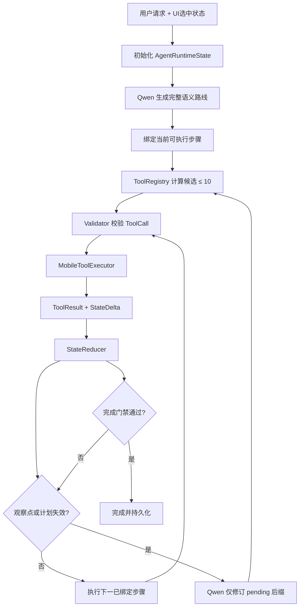

# Agent Runtime 架构 v2：受限候选、显式数据流与有界闭环

> 状态：权威设计；31/31 executor 与 30/30 动态绑定验收通过，生产默认已切换为 `loop`
>
> 更新日期：2026-10-26
>
> 适用范围：Android 端 Qwen 规划、素材检索、工具执行、状态恢复与审计
>
> 配套实施计划：[`agent_runtime_migration_plan.md`](agent_runtime_migration_plan.md)
>
> Runtime v2已于2026-10-29冻结为`runtime-v2-linear-prod-20261029`。后续Content Graph与
> 类型化DAG实验见[`agent_runtime_v3_dag_design.md`](agent_runtime_v3_dag_design.md)；
> v3在shadow阶段不改变本文规定的生产loop行为。

## 1. 文档目的与当前边界

本文档替代 2026-10-13 版本的“常驻大脑 + 每步监督”方案，作为下一阶段 Android Agent
运行时改造的唯一架构依据。

本次调整来自真机实验得到的三条事实：

1. 模型每轮看到约 30 个工具时，语义选择稳定性下降；候选工具必须按状态动态收敛，
   **单次模型决策最多展示 10 个具体工具**。
2. `Qwen3-4B-Instruct-2507` 是 non-thinking 4B 模型。自由草稿再格式化的 2-Turn 实验
   没有提升理解，反而把错误结构化并将延迟提高到约两倍。
3. Android 不需要 LangChain 才能实现闭环。闭环本质是“状态 → 决策 → 工具 → 结果 →
   状态”的有界状态机，可以直接用 Kotlin 实现。

下述架构已经实现并完成逐工具真机验收，手机生产默认现为 `agentRuntime=loop`，文本策略仍为
`plannerExperiment=baseline`。旧 static runtime 继续作为显式回滚路径，不再是默认执行架构。

---

## 2. 当前实现与主要结构性问题

当前无手选素材时的实际链路是：

```text
GenieTextPlanner.tryIntent()
  → MobileAgentRunner 只提取 search_assets 的 query/k
  → 丢弃 intent plan 中其余步骤
  → BGE 检索并 prepare 素材
  → MobilePlanner 从原始请求重新规划
  → forEach 静态执行最终工具链
```

static 路径已经能稳定支撑演示，但不是完整 Agent 闭环：

| 问题 | 当前表现 | 影响 |
|---|---|---|
| `search_assets` 不是一等执行工具 | Runner 在工具循环外截取并消费 | 初始计划无法延续，检索结果没有作为标准 ToolResult 回流 |
| 两份互不相连的计划 | 检索前计划被丢弃，检索后从头规划 | 无法审计“原计划为何被修改” |
| 工具结果不回到模型 | 最终计划一次生成后静态执行 | 数量不足、媒体类型变化或 SDK 失败不能修正剩余步骤 |
| 工具链数据流不显式 | 多数编辑工具重新读取源素材，只有导出读取 `lastOutput` | “滤镜 → 倒放”可能不是串行叠加，而是后一步覆盖前一步 |
| 状态通过局部变量和可变 JSON 传播 | `assets`、`workingLayout`、`lastOutput` 分散在 Runner | 替换素材后容易产生陈旧 ID、槽位错位和审计污染 |
| 工具约束有多份来源 | prompt、parser、registry、executor 分别判断 | 可见工具与真实可执行能力可能不一致 |
| 隐式副作用 | Runner 尾部自动发布；`asset_replace` 内部自行检索 | 工具链无法完整表达实际发生的操作 |
| 失败直接中止整链 | 大部分执行异常最终进入顶层 catch | 已完成前缀和可恢复中间产物不能用于局部修正 |

这些问题必须先在运行时解决，再调整 prompt 或建设长链数据集。

---

## 3. 目标与非目标

### 3.1 目标

- 用户没有手选素材时，模型可以先规划完整**语义路线**，并把 `search_assets` 作为第一步；
- 检索结果、媒体类型、素材数量和工具产物进入统一状态；
- 每次模型选择只看到当前真正可执行且不超过 10 个的具体工具；
- 已执行步骤保留，环境变化时只重规划尚未执行的后缀；
- 工具输出显式成为下一工具输入，多步效果可真正串联；
- 搜索不足、工具失败和素材替换可以触发有限修正，而不是整链静默失败；
- 所有计划版本、候选目录、工具实参、结果和状态变化可审计；
- 不依赖 LangChain、Python 服务或联网能力。

### 3.2 非目标

- 第一阶段不实现常驻 `genie-app` 或 JNI `GenieDialog`；它们是延迟优化，不是闭环前提；
- 不在每个成功工具后都调用模型；端侧延迟不允许无限 ReAct；
- 不让模型直接管理文件路径、Content URI 生命周期或 SDK backend；
- 不在本阶段更换 Qwen/VLM/BGE 权重；
- 不先扩展正式长链评测集。架构落地期间只增加必要的状态机和工具契约单元测试；
- 不删除现有 static baseline，直到 loop runtime 通过真机验收。

---

## 4. 不可违反的架构规则

以下规则使用“必须”表示实现门禁，而非建议。

### R1：模型负责语义，运行时负责事实

- Qwen 决定用户目标、语义路线、效果和候选工具中的最终选择；
- Kotlin 负责 UI 选中状态、媒体类型、素材数量、文件存在性、SDK 能力和安全边界；
- 确定性代码可以排除不可能工具，但不能用关键词表替模型决定用户想做什么。

### R2：注册工具数与可见工具数分离

- 注册表可以包含 30 个或更多真实 executor；
- 单次模型决策可见的**具体工具不得超过 10 个**；
- 超过 10 个时必须进一步按语义能力族或状态拆分，禁止按注册顺序静默截取前 10 个。

### R3：工具约束只有一个事实源

每个工具必须由统一 `ToolSpec` 声明输入、输出、媒体要求、数量、选择状态和副作用。
prompt catalog、parser 校验和执行前校验都读取同一份定义，不能再维护三套近似规则。

### R4：所有跨步骤数据都有显式引用

- 源素材使用 `AssetSetRef`；
- 工具产物使用 `ArtifactRef(stepId)`；
- 布局使用 `LayoutRef`；
- 后续工具不得通过隐式 `lastOutput` 猜输入，也不得默认重新读取原素材。

### R5：工具只能通过 StateDelta 改变状态

executor 返回 `ToolExecutionResult(result, stateDelta)`。素材替换、轨道写回、布局交换、
产物生成和发布 URI 都由 reducer 应用，禁止工具分支任意修改共享 plan JSON。

### R6：搜索和发布都是一等工具

- `search_assets` 必须进入普通执行循环并产生标准 ToolResult；
- 检索类子操作不能隐藏在另一个工具里而不留审计记录；
- loop runtime 中最终发布必须是显式步骤，禁止 Runner 在不知道计划语义时自动发布；
- static baseline 在迁移期可以继续保留现有尾部发布行为。

### R7：先规划完整语义路线，再延迟绑定具体实现

素材未知不妨碍规划：

```text
retrieve → compose → style → publish
```

但素材未知时不得凭空绑定 `video_filter`、`live_photo_filter_effect` 等 backend-specific 工具。
搜索完成后，根据实际状态生成不超过 10 个具体候选，再绑定剩余路线。

### R8：已执行前缀不可重写

重规划只允许替换 `pending` 后缀。`completed` 步骤、真实 ToolResult 和状态变化必须保留。
如需撤销破坏性操作，必须有显式补偿工具，不能通过改写历史假装它没有发生。

### R9：闭环由观察点驱动，不是每步 ReAct

以下情况才调用模型修正或绑定计划：

- `search_assets` 返回真实素材；
- 工具失败或结果不满足声明的后置条件；
- `asset_replace` 等操作改变素材集合或 ID；
- 用户确认或歧义需要处理；
- 当前步骤使剩余计划的前置条件失效。

普通、确定性的成功编辑后，如果剩余计划仍可执行，应直接继续。

### R10：循环必须有界

初始默认限制：

- 最多 8 个已执行工具步骤；
- 最多 2 次 plan revision；
- 模型输出解析失败最多重试 1 次；
- 仅幂等工具允许自动执行重试，最多 1 次；
- 发布、替换等破坏性/外部副作用工具默认不自动重试。

达到上限后必须明确失败并保留审计，不得无限循环。

### R11：模型的 `finish` 不是成功的唯一依据

任务完成需要同时满足：

- 没有未完成的必需步骤；
- 预期 deliverable 已生成；
- 文件、URI 和媒体轨道通过确定性校验；
- 不存在失败但未处理的步骤。

模型可以建议 `finish`，但不能越过这些事实门禁。

### R12：生产路径与实验路径隔离

新增独立配置：

```text
agentRuntime=static | loop
```

它与 `plannerExperiment=baseline|p1|scratchpad|two_turn` 分离。完成 31/31 executor、
30/30 binder 和最终长链回归后，默认值已切换为 `loop`；`static` 通过构建参数保留回滚。

---

## 5. 模型与运行时职责

| 组件 | 职责 | 不负责 |
|---|---|---|
| Qwen3-VL | 素材入库时生成内容与动作语义 | 用户意图、工具选择 |
| BGE | `search_assets` 内部对 query 与已索引素材排序 | 判断用户要执行什么编辑 |
| Qwen 文本模型 | 语义路线、效果、具体候选工具选择、必要时修订后缀 | 文件状态、SDK 兼容性、安全校验 |
| ToolRegistry / Validator | 基于事实过滤和验证工具 | 根据关键词替用户决定意图 |
| ToolExecutor | 调 SDK，返回结果与 StateDelta | 修改计划、决定下一步 |
| AgentLoop | 驱动状态机、限制次数、调 planner/executor | 猜测用户语义 |

语义能力族首版限定为 8 个：

```text
RETRIEVE / COMPOSE / STYLE / TEMPORAL
LAYOUT / REPLACE / ANALYZE / PUBLISH
```

`CHAT` 和 `ASK` 是决策类型，不是媒体工具。能力族用于素材未知时规划路线，也用于把具体工具
候选收敛到 10 个以内。

---

## 6. 总体架构



这是一套 Kotlin `Plan-Execute-Replan` 状态机，而不是依赖 LangChain 的运行图。

---

## 7. 两层规划协议

### 7.1 第一层：完整语义路线

素材未知时，模型看到能力族而不是 30 个实现工具。协议保持短、直接，不使用
“自由描述 → formatter”的 2-Turn。

示例请求：`找三张猫的 Live Photo 做三拼，再调成黑白并导出`

概念输出：

```text
ROUTE=RETRIEVE|猫|3|livephoto
ROUTE=COMPOSE|三拼
ROUTE=STYLE|黑白
ROUTE=PUBLISH|
```

Host 为步骤分配稳定 `step_id`。模型不生成文件路径，也不在搜索前编造 asset ID。

### 7.2 第二层：具体工具绑定

`search_assets` 返回并 prepare 真实素材后，Registry 根据路线、当前输入引用与状态生成具体
目录。例如直接编辑源 Live Photo 时，STYLE 可以暴露 `live_photo_filter_effect`；如果上一步
拼贴已经产出 VIDEO artifact，同一个 STYLE 阶段则应暴露 `video_filter`。不能只依据最初素材
类型过滤工具。

模型只需在当前目录中给出直接结构化调用：

```text
STEP=template_collage|三拼
STEP=video_filter|黑白
STEP=publish_result|
```

是否允许一次绑定多个连续步骤由实现阶段验证；无论一次还是多次绑定，都必须遵循同一状态和
前置条件校验。

### 7.3 搜索约束从下游路线反向传播

路线中的后续能力可以约束搜索：

| 后续意图 | 搜索约束示例 |
|---|---|
| 倒放、变速、转场 | `has_video=true` |
| Live Photo 换封面 | `media_format=livephoto` |
| 三段视频堆叠 | `min_count=3, has_video=true` |
| 三拼 | `min_count=3`，具体可接收类型由 COMPOSE ToolSpec 决定 |

约束来源是模型选择的语义路线与 ToolSpec，不是关键词工具路由。

---

## 8. 运行状态与数据流

### 8.1 AgentRuntimeState

目标状态至少包含：

```text
session_id / turn_id / original_query
source_assets                 当前素材集合及稳定顺序
selected_asset_ids            UI事实
layout                        当前布局及版本
artifacts                     每个步骤产物
semantic_route                完整语义路线
runtime_plan                  当前具体计划版本
completed_steps / pending_steps
available_tool_snapshot       上一次模型实际看到的目录
replan_count / executed_count
status                        running / waiting_user / finished / failed / cancelled
published_uris
```

内存状态用于执行；每个计划版本和工具边界后将可恢复摘要写入 SQLite。状态中的 `JSONObject`
必须深拷贝或转成不可变表示，避免异步审计看到被后续原地修改的内容。

### 8.2 AgentArtifact

每个中间产物必须记录：

```text
artifact_id
kind = IMAGE | VIDEO | LIVE_PHOTO | PALETTE | JSON | LAYOUT
producer_step_id
local files / content uri
media metadata
validated
temporary / published
```

Live Photo artifact 应显式携带封面、运动轨道、封装文件和 photo timestamp，不能仅用
“最后一个 File”表示。

### 8.3 输入引用

具体 ToolCall 的输入只能是：

```text
AssetSetRef(asset_ids)
ArtifactRef(step_id 或 artifact_id)
LayoutRef(layout_version)
```

例如 `filter → reverse → publish` 必须形成：

```text
filter.output → reverse.input
reverse.output → publish.input
```

不能让 `reverse` 再次读取 filter 之前的源文件。

### 8.4 StateDelta

首版需要支持：

```text
AddAssets / ReplaceAsset / RemapSelection
AddArtifact / ValidateArtifact
UpdateLayout
MarkStepCompleted / MarkStepFailed
PublishArtifact
SetStatus
```

Reducer 在应用 Delta 后统一检查引用完整性、素材顺序、选中集合和 layout 中的 asset ID。

---

## 9. ToolSpec 与候选过滤

每个工具的规格至少包含：

```text
id / family / description
accepted_inputs / produced_output
media_requirement
min_assets / max_assets
min_video_tracks / max_video_tracks
selection_arity
requires_layout / requires_artifact
observation_barrier
destructive / idempotent / singleton
```

候选过滤顺序固定为：

1. 当前路线步骤的 `family`；
2. UI 选中范围；
3. 实际目标素材的媒体能力；
4. 素材与视频轨道数量；
5. layout / artifact / SDK 等运行时前置条件；
6. 已完成的 singleton 和破坏性步骤；
7. 候选数上限检查。

过滤结果处理：

| 数量 | 行为 |
|---:|---|
| 0 | 形成结构化不可执行原因，触发 revise 或 ASK |
| 1～10 | 把完整目录和状态摘要交给模型选择 |
| >10 | 视为架构错误，继续按子能力拆分；禁止静默截断 |

parser 和 executor 必须再次使用相同 ToolSpec 验证，防止模型输出未展示工具或状态在异步期间变化。

---

## 10. 有界执行闭环

概念流程：

```text
state = initialize(request, UI state, session state)
route = brain.planRoute(state, semanticFamilies)

while not terminal:
    ready = plan.nextReady(state)

    if ready 未绑定或前置条件失效:
        catalog = registry.available(state, ready.family)   # 1..10
        decision = brain.bindOrRevise(state.compact(), route.remaining, catalog)
        validate(decision)

    result = executor.execute(call, state)
    state = reducer.apply(state, result.delta)
    audit(call, result, state)

    if result 失败或 observation_barrier:
        标记需要校验/修订 pending 后缀

    enforceLimits()
    checkTerminalGate()
```

### 10.1 允许的模型决策

```text
CALL       从给定候选中绑定/执行下一工具
REVISE     替换尚未执行的路线或具体步骤
ASK        缺少用户才能提供的信息
FINISH     建议结束；仍需通过 Runtime 完成门禁
FAIL       说明当前能力无法完成
```

模型不得修改 `completed_steps`，也不得用 `CALL` 指向目录外工具。

### 10.2 不触发模型调用的情况

- 工具成功且后置条件满足；
- 下一具体步骤已经绑定且仍满足 ToolSpec；
- 仅更新确定性的进度百分比；
- 发布后只需验证 URI/媒体文件。

这使闭环具备纠错能力，同时避免纯 ReAct 的线性延迟放大。

---

## 11. 关键 corner cases 与统一处理

下表覆盖首版必须处理的问题，不扩展到尚不存在的能力。

| 场景 | 处理规则 |
|---|---|
| 普通聊天/能力询问 | 在任何检索前直接 `CHAT`；不得加载无关素材 |
| 无手选素材的编辑请求 | 首个可执行动作通常为 `search_assets`；完整语义路线可以提前存在 |
| 搜索返回 0 条 | 不进入编辑工具；最多 revise 一次查询，否则 ASK/FAIL |
| 返回数量少于计划需求 | 不用不足素材强行执行；允许补搜、降级方案或询问用户 |
| 返回数量多于需求 | 搜索工具按分数和约束选定固定集合，并记录候选与取舍，不把数量决策留给 SDK |
| 混合图片/视频/Live Photo | 按目标 `AssetSetRef` 计算能力；要求同质输入的工具必须隐藏或拒绝 |
| 用户已经手选素材 | 选中状态是事实，跳过全库检索；后续编辑默认只作用于选择集合 |
| 选中数量变化 | 重新计算目录；例如 `layout_swap` 仅在选中 2 个且已有布局时可见 |
| 素材替换 | 返回旧→新 ID 映射；原槽位、选择状态和剩余步骤引用由 reducer 原子更新 |
| 布局不存在或槽位数不符 | 隐藏布局操作或重建匹配模板；禁止渲染黑槽 |
| 多步效果串联 | 后一步必须消费前一步 artifact；禁止默默回到 source asset |
| 重复 singleton/破坏性工具 | validator 拒绝；相同 idempotency key 不得二次执行 |
| SDK 失败但产生临时文件 | 标记 artifact 未验证，不发布；保留诊断路径并允许最多一次合法修订 |
| 用户取消 | 停止发起新工具，调用 SDK cancel；状态记为 `cancelled`，不自动发布 |
| App/进程在步骤间退出 | 从 SQLite checkpoint 恢复并验证文件；缺文件则明确失败。首版不恢复进行中的 SDK 调用 |
| 模型超时/不可解析 | 保留原文，最多重试一次；loop runtime 不用关键词表静默伪造复杂计划 |
| BGE/VLM 不可用 | 返回结构化能力错误；不得用随机素材或虚构语义继续执行 |
| MediaStore URI 失效 | 搜索结果绑定前验证；剔除后数量不足则触发 revise |
| 发布重复 | publish 使用 turn/step idempotency key；已有有效 URI 时返回原结果，不重复插入 MediaStore |
| 模型提前 FINISH | Runtime 发现必需产物或 publish 缺失时拒绝完成并要求修订 |
| 历史“这张/中间那个” | 只通过当前 selection/layout 状态解析；历史文本不能覆盖最新 UI 事实 |

---

## 12. 审计与恢复

现有 `interaction_events` 继续作为真机事实源，并新增/规范以下事件：

| 事件 | 内容 |
|---|---|
| `ROUTE_BRAIN` | 原始路线输出、模型耗时、协议版本 |
| `PLAN_VERSION` | plan id/version、父版本、completed/pending、修订原因 |
| `TOOL_CATALOG` | 当前状态下真实展示给模型的候选工具及排除原因摘要 |
| `TOOL_CALL` | step id、输入引用、最终参数、idempotency key |
| `TOOL_RESULT` | success、payload 摘要、artifact、错误与 backend |
| `STATE_DELTA` | 素材/选择/布局/产物变化，不记录大文件内容 |
| `TERMINAL` | finished/failed/cancelled、完成门禁结果、最终 URI |

每条记录必须带 `session_id`、`turn_id` 和 `plan_version`；步骤级事件还必须带 `step_id`。
日志对象在入队前深拷贝，避免异步写入时被执行线程继续修改。

SQLite checkpoint 至少写在：

- 初始路线生成后；
- 每次计划修订后；
- 每个工具结果和 StateDelta 应用后；
- 发布和终态后。

---

## 13. 模型进程与 Android 生命周期

闭环首版继续复用当前一次一进程的 `genie-app` 调用。理由：

- 当前 Stage A/Stage B 已证明一次用户请求内顺序调用模型可行；
- 状态由 Kotlin/SQLite 持有，不依赖模型内部对话常驻；
- 先验证执行语义，避免同时引入常驻进程、内存和协议风险。

后续只有在 loop 正确且延迟成为主瓶颈时，才单独评估：

1. 常驻 CLI dialog；
2. 前台 Service 生命周期；
3. JNI `GenieDialog`；
4. Qwen 与 VLM 的内存/热调度。

这些优化不得与第一版 loop 改造绑在同一次变更中。

---

## 14. 降级、兼容与发布规则

- static baseline 保持现状，作为显式回滚路径；
- loop runtime 不读取 P1/scratchpad/two_turn 作为默认策略，首版只使用直接结构化生成；
- loop 的复杂规划失败时，优先明确 ASK/FAIL，不用关键词表生成看似成功的长链；
- 媒体兼容、数量、选择范围、低相似度替换等确定性 guard 始终保留；
- session JSON 新字段必须可选并带 `runtime_state_version`，旧会话不能因此崩溃；
- 数据库变更优先使用可向前兼容的 JSON 字段，确需 schema migration 时单独提交；
- 新能力先在 `agentRuntime=loop` 下验证；默认已完成独立切换决策，回滚仍使用 `static`。

---

## 15. 首版架构验收条件

正式建设长链数据集前，loop runtime 至少满足：

1. `search_assets` 出现在普通 `TOOL_CALL/TOOL_RESULT` 中，不再由 Runner 特判后丢弃计划；
2. 每次 `TOOL_CATALOG` 的具体工具数量均在 1～10；
3. `filter → reverse → publish` 等链路中，后一步确实消费前一步 artifact；
4. 素材替换后 selection、layout 和 pending plan 中不再残留旧 ID；
5. 搜索数量不足时不会调用不满足 arity 的工具；
6. SDK 失败不会发布未验证中间结果，并能在限制内 revise 或明确失败；
7. 重复 publish/replace 不产生重复副作用；
8. App 在步骤边界重建后能恢复或明确说明不可恢复，不能静默从头重复执行；
9. static baseline 的 assemble、lint 和现有回归保持通过；
10. 切换前完成逐工具验收；切换后 `agentRuntime=static` 回滚构建仍可通过。

---

## 16. 已确定的架构决策

| 编号 | 决策 |
|---|---|
| A1 | 总注册工具可超过 10，但单次模型可见具体工具必须 ≤10 |
| A2 | 数量、媒体、选择和布局过滤是事实门禁，不是关键词意图路由 |
| A3 | 首轮规划完整语义路线，具体 backend 工具延迟到真实素材就绪后绑定 |
| A4 | `search_assets` 和 publish 都是一等工具 |
| A5 | 使用显式 ArtifactRef 串联工具，不再依赖隐式 `lastOutput` |
| A6 | 使用 Kotlin 有界 Plan-Execute-Replan，不引入 LangChain |
| A7 | 仅在观察点、失败或计划失效时调用模型，不做每步 ReAct |
| A8 | 已执行前缀不可改写，只修订 pending 后缀 |
| A9 | 常驻大脑延后，先用现有 stateless `genie-app` 验证闭环 |
| A10 | 架构先落地，正式长链轨迹集在运行时稳定后建设 |
| A11 | loop 为生产默认；static baseline 通过独立开关保留回滚 |
| A12 | 模型负责语义选择；确定性代码负责兼容性、安全和副作用边界 |
