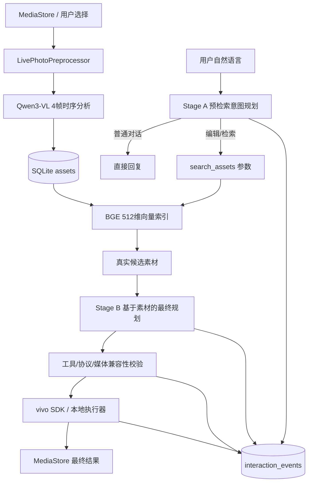

# Live Photo Agent 端侧部署与可靠性优化技术报告

> 日期：2026-10-22  
> 项目：`live_photo_agent` Android 端侧 Agent  
> 验证设备：vivo PD2547 / V2547A（Android 16，arm64-v8a，SM8850 平台）  
> 报告范围：端侧模型、素材索引、Agent 规划、vivo SDK 执行、真机测评与可靠性优化

---

## 1. 摘要

本项目将原本主要运行于 Python/服务端环境的 Live Photo Agent，迁移为可在 vivo 手机上
独立完成素材理解、语义检索、工具规划、媒体编辑和结果发布的端侧应用。

当前系统已经形成以下闭环：

1. 使用端侧 Qwen3-VL 对 Live Photo 多帧内容做离线语义分析；
2. 使用 BGE ONNX 模型在本地 SQLite 素材库中做语义检索；
3. 使用 Qwen3-4B-Instruct-2507 W4A16 做意图理解和工具链规划；
4. 使用 vivo LivePhotoSDK、VideoEditorSDK、MediaEffectSDK 和 ImageProcessSDK 执行编辑；
5. 将最终图片、视频或 Live Photo 发布到系统相册；
6. 使用 SQLite 审计模型原文、最终计划、工具实参和执行结果，支持问题回放。

工程优化重点并不是单纯“把模型跑起来”，而是解决端侧小模型、静态 QNN 图、厂商 SDK、
素材状态和 UI 会话共同构成的系统可靠性问题。最终形成的原则是：

> **模型负责理解和规划；检索、素材作用域、媒体兼容性与执行安全由确定性代码保证。**

---

## 2. 项目目标与端侧约束

### 2.1 目标

- 用户通过自然语言检索本地照片、视频和 Live Photo；
- 根据素材内容生成拼贴、滤镜、裁剪、变速、倒放、镜像等工具链；
- 支持会话内继续编辑、换模板、交换槽位和语义替换素材；
- 所有核心模型和素材信息留在本机；
- 规划、工具调用和执行结果可审计、可复现；
- 在无服务端媒体处理的情况下完成真实 SDK 导出。

### 2.2 主要约束

| 约束 | 工程影响 |
|---|---|
| QNN/HTP 图形状静态 | VLM 输入尺寸、patch 数量和上下文预算不能运行时任意改变 |
| 文本模型仅 4B 且 W4A16 | 工具候选过多、复杂 schema、占位符容易导致语义漂移或格式复读 |
| Genie 栈无 grammar/JSON Schema 约束解码 | 只能依靠 prompt、简化协议、parser 和执行前校验 |
| vivo SDK 为内部 AAR | 缺少 POM 和公开文档，需要反查依赖并做真机探针 |
| Live Photo 同时包含图片与运动轨道 | 需要拆包、编辑视频、重新封装并保留时间戳语义 |
| 长时间 NPU 推理产生高温 | 全量相册索引必须做主动节流、断点复用和缓存治理 |
| Android Content URI 与沙箱 | 所有输入、缓存、数据库、MediaStore 发布都需做生命周期管理 |

---

## 3. 当前已落地的总体架构



### 3.1 三类模型的职责

| 模型 | 部署方式 | 实际职责 |
|---|---|---|
| Qwen3-VL-4B-Instruct-W4A16 | Qualcomm QNN/Genie，HTP | 素材入库时分析主体、场景和动作趋势 |
| BGE-small-zh-v1.5 | ONNX Runtime Android，CPU | 将用户搜索词与素材摘要编码为 512 维向量并排序 |
| Qwen3-4B-Instruct-2507 W4A16 | Qualcomm QNN/Genie，HTP | 交互时做意图理解、搜索词提炼和工具规划 |

职责边界是明确的：VLM 不负责选择编辑工具，BGE 不负责识别用户意图，文本 Qwen 不直接
遍历相册文件。

### 3.2 当前大脑的实际运行方式

`agent_brain_design.md` 曾设计常驻 `AgentBrainService` 和逐步监督循环，但这部分目前仍是
后续目标。当前生产实现是：

- `GenieTextPlanner` 每次调用创建一个 `genie-app` 子进程；
- 单次 `runText()` 超时上限为 30 秒；
- Stage A 和 Stage B 分别调用一次模型；
- 规划完成后由 `MobileAgentRunner` 顺序执行工具；
- 尚未实现每个工具结果回喂模型后再决定 `revise/finish` 的监督循环；
- 正常构建使用 `plannerExperiment=baseline`、`plannerEvalOnly=false`。

因此报告中的“当前架构”不把尚未实现的常驻服务和多步自修正描述成已交付能力。

---

## 4. 端侧部署工作

### 4.1 QNN 文本模型部署

完成了 Qwen3-4B-Instruct-2507 W4A16 的端侧接入：

- 模型配置、tokenizer、QNN binary 和 DSP runtime 放入独立模型包；
- `ModelPack` 将模型与 runner 复制到 App 私有目录，避免外部存储执行权限问题；
- APK 打包 `libGenie.so` / `genie-app` 相关运行库；
- 配置 `LD_LIBRARY_PATH` 与 `ADSP_LIBRARY_PATH`；
- 使用 Genie dialog 脚本设置输出 token 上限并读取结果文件；
- 模型失败、超时或解析失败时保留原始输出，便于审计和降级。

当前文本模型是官方明确的 **non-thinking-only** 变体。`<think>` token 存在于共享词表中，
不代表该权重支持原生 thinking；缺失原生 thinking 不是 W4A16 量化造成的。

### 4.2 QNN VLM 素材语义分析

Live Photo 的语义不只包含封面内容，还需要识别 1.5～3 秒运动轨道中的动作变化。早期对
每帧独立调用 VLM，模型无法比较帧间变化，曾把静止的猫描述成 running/walking/dancing。

最终使用固定 512×512 画布的 2×2 时序网格：

```text
抽帧：0% / 33% / 66% / 100%
排列：左上 → 右上 → 左下 → 右下
每格：256×256 = 16×16 patch
总计：4 × 256 = 1024 patch
```

该方案正好匹配 QNN 视觉图编译时固定的 32×32 patch 预算，无需修改 RoPE 位置编码。

效果：

- 单素材由 3 次推理降为 1 次；
- 耗时由约 45～60 秒降到 15～20 秒；
- grid-v3 全量验证中 102/102 条使用 4 帧；
- 能区分真实运动与静止；
- 删除会污染检索的网格位置描述。

同时修复了：

- 100% 时间点抽帧越界：clamp 到 `durationUs - 1`；
- `frameLimit` 与网格最大帧数漂移：统一引用 `MAX_GRID_FRAMES`；
- prompt 写死空格位置：改为按实际帧数生成布局说明；
- 失败帧保持相对时序，不用文件名推断顺序。

### 4.3 BGE 本地语义检索

素材的 VLM 结果写入 SQLite 后，由 `BgeEmbedder` 在 CPU 上计算归一化 512 维向量。

检索链路为：

```text
用户原话
→ Qwen 提炼 query 与 k
→ BGE 编码 query
→ SQLite 中向量余弦分数
→ 关键词/tag 命中数辅助排序
→ Top-K 真实素材 URI
```

BGE 只负责“找哪张素材”，不参与“调用哪个编辑工具”。这避免了把 embedding 相似度误用为
工具路由器。

### 4.4 vivo SDK 集成与离屏渲染验证

完成并验证了以下 SDK 链路：

| SDK/组件 | 已接入能力 |
|---|---|
| LivePhotoSDK 2.4.20.0 | Live Photo 判断、拆包、封面/运动轨道解码、重新封装 |
| VideoEditorSDK 4.9.0.3 | 裁剪、拼贴、镜像、模糊、变速、倒放、转场、画布适配 |
| MediaEffectSDK 1.3.2.2 | 时间线动效、Live XDR 资源查询等可用路径 |
| ImageProcessSDK | 提亮、锐化、降噪、色调、美颜及 CPU 主色分析 |
| Android Canvas | 模板布局编辑、拖拽、缩放、旋转和调色板图生成 |

真机前台 Service 探针证明 `VMEditor` 可以不依赖可见 Window 完整离屏导出，解决了 Agent
执行必须绑定前台编辑页的架构风险。

SDK AAR 未声明的依赖通过字节码和真机崩溃反查补齐：

- `gson:2.11.0`；
- `libpag:4.2.41`；
- 自建 `vivo.util.VLog` stub；
- 对非公开 AAR、JNI `.so` 建立来源和 md5 记录。

探针同时确认若干能力不可用，避免把不可执行功能注册给模型：

- `processSegmentPoints` 不是人像分割模型；
- `GPUMattingFilter` 无法脱离厂商渲染图独立驱动；
- `VMEditMotionEffectEngine` 离屏不产生纹理；
- 人像分割、跟随贴纸仍需要额外模型或资源。

### 4.5 构建、安装和模型恢复

部署脚本完成了以下治理：

- 安装前备份 SQLite 素材库；
- 修复 Bash `UID` 只读变量导致模型部署中断；
- 重装后恢复数据库并重新设置 App UID 属主；
- 部署模型目录和 DSP skeleton 软链接；
- 构建固定为 Java 17、arm64-v8a；
- 真机测试使用 ADBKeyboard 输入中文，测试结束后恢复 vivo 原生输入法并禁用 ADBKeyboard。

---

## 5. 素材库、缓存与热管理优化

### 5.1 增量索引与版本治理

`LibraryDatabase` 保存：

- 素材稳定 ID 与 Content URI；
- 媒体格式、尺寸、时长等 metadata；
- VLM semantic JSON；
- BGE embedding；
- 指纹和更新时间；
- 会话状态、聊天消息和交互审计。

通过 `analysis_version` 和媒体指纹判断是否需要重新分析。prompt、schema 或抽帧方式变化时
提升版本号，旧结果会被物理清理并重新生成，避免旧向量永久污染检索。

### 5.2 删除无输入依据的字段

VLM pipeline 没有音频输入，旧 schema 却要求 `audio_tags`，导致模型编造 wind、waves、birds
等标签并进入 BGE 文本；现已从 Android/Python 两侧删除。

`quality_score` 也被删除。量化小模型生成数字 token 不等同于连续值回归，真机分数高度聚簇、
与质量无关。当前原则是：

> 让量化小模型做描述和离散分类，不让它承担未经校准的数值测量。

### 5.3 缓存和数据库连接泄漏

曾出现索引过程重复创建 `SQLiteOpenHelper`、缓存目录增长到 1.3GB、全量任务固定位置被系统
杀死。优化包括：

- `LivePhotoPreprocessor` 生命周期内复用一个数据库 helper；
- 索引任务只保存语义结果，完成后删除每个素材的解码副本；
- `ready/settled` 失败状态写回数据库，确定性失败不无限重试；
- App 生成目录从索引扫描中排除，避免结果反复成为新输入。

### 5.4 NPU 热保护

SM8850 连续处理约 102 个素材时，Hexagon 传感器可升至 99.7℃并被系统强制停止。纯温度
反应式保护来不及阻止单次 15～20 秒推理中的快速升温，因此实现 `ThermalGuard`：

- 按 genie-app 调用次数计数，而非按素材数；
- 每 6 次推理主动休息；
- 75℃暂停、降到 60℃以下恢复；
- 自动发现 `nsphmx/nsphvx` thermal zone；
- 最长等待 5 分钟，防止异常传感器导致永久阻塞。

---

## 6. Agent 意图理解与工具规划改造

### 6.1 从关键词主导改为“大脑优先、规则兜底”

早期 `MobilePlanner` 主要依靠关键词表，未知表达会静默漏掉动作。例如“反转”没有命中规则时，
计划看似成功但实际少一步。当前顺序改为：

```text
模型规划
→ parser / registry / 素材作用域校验
→ 模型不可用或计划不可执行时才进入确定性兜底
```

硬编码仍存在，但明确定位为故障恢复和执行安全，不包装成模型能力。

### 6.2 两阶段规划

#### Stage A：预检索意图

在用户未提供 URI、也未选中素材时：

- 判断聊天还是编辑；
- 提炼 `search_assets.query` 和 `k`；
- 普通聊天直接回复；
- 编辑请求进入 BGE 检索。

Stage A 只提供检索参数，不直接作为最终执行计划。

#### Stage B：真实素材就绪后的最终规划

模型看到真实素材的 metadata、VLM 摘要、选中标记、会话上下文和可用工具后，输出最终工具链。
这样避免预检索模型在不知道素材类型时决定具体执行器。

### 6.3 简化规划协议

旧协议要求：

```text
ACTION=PLAN
STEP=工具|effect|start_ms|end_ms|素材序号|用户原话证据
```

真机数据表明：

- 模型仅约 17% 的 STEP 输出保留 `ACTION=`；
- 时间、序号、证据槽位有 50% 占位符回声；
- parser 大量依靠“看见 STEP 就接受”的隐式兜底。

P2a 将协议简化为：

```text
STEP=工具|effect
QUESTION=追问
REPLY=回答
```

可选参数改为后缀：

```text
@start-end
#ordinal
```

删除从不进入执行器的“用户原话证据”槽位，并允许无需 effect 的工具只输出工具 ID。

结果：

- `protocol_clean_rate`：0.167 → 1.000；
- 旧占位符回声归零；
- 解析出的 STEP 轮次显著增加；
- `ACTION=` 退役后未再复活。

### 6.4 工具目录与媒体兼容性过滤

小模型对候选工具数量和描述非常敏感。Android `smart_collage` 没有消费 VLM 语义，与
`template_collage` 执行分支相同，却多一个失败门，因此从 Android registry 移除；Python
侧真实 VLM-scored 实现不受影响。

最新真机故障中，三张 JPG 被规划为 `video_vertical_stack`，并最终触发
`SDK does not support video: null`。为此增加三层保护：

1. final prompt 根据真实 scoped assets 隐藏不可执行工具；
2. parser 拒绝多余 `|`，并再次校验工具与媒体类型、数量；
3. executor 对单视频、双视频、三视频工具检查真实输入数量。

同时将已有的“明确编辑动作”保护前移到 Stage A：模型仍先做判断，但明确包含拼接、滤镜、
倒放、镜像等动作的请求，不能被空工具 chat 回复直接吞掉；后续仍由 BGE 和最终大脑选工具。

### 6.5 选中态与素材作用域

UI 选择是确定性事实，不能由模型猜测：

- 无选中：动作默认作用于当前全部素材；
- 一个选中：可显示 `asset_replace`；
- 两个选中：可显示 `layout_swap`；
- prompt 中用 `[已选中]` 标记素材；
- runner 在执行前将 `asset_ids` 收敛到选择集合；
- 替换后选择状态迁移到新素材，后续“这张”仍指向同一个槽位。

---

## 7. 会话式编辑与布局一致性修复

### 7.1 替换素材后黑屏和错位

现象：`猫1、猫2、猫3` 中把猫2替换为狗后，结果变成 `猫1、猫3、黑屏`。

根因：`template_collage.asset_ids` 是规划时快照；`asset_replace` 已将运行时阵容改为
`猫1、狗、猫3`，后续 collage 仍用旧 ID 过滤，狗和旧猫2都被丢弃，只剩两个输入进入三槽模板。

修复：

- 检测 asset ID 快照是否过期；
- 过期时从实时 `workingLayout.items` 获取当前阵容；
- 替换只修改槽位中的 `asset_id`，保留几何和时间窗口；
- 布局槽位数与素材数不一致时重新解析模板，禁止静默黑槽。

真机复测恢复为 `猫1、狗、猫3`。

### 7.2 交换位置执行两次等于没有交换

模型曾连续输出两条相同 `layout_swap`，交换两次后回到原位。修复包括：

- `layout_swap`、`asset_replace`、`template_collage` 作为 arity-strict singleton 操作去重；
- 交换 `layout_context.items` 中两个 `asset_id`，不交换槽位几何；
- 自动追加按原布局重拼。

### 7.3 “换滤镜”被识别成“换素材”

“这张滤镜换成黑白”曾被解析为 `asset_replace(query=黑白)`，从素材库换入一张低相关图片。

修复：

- prompt 明确区分“改变画面内容”与“改变颜色/风格”；
- replacement 语义检索增加最低余弦阈值 0.48；
- 低于阈值时保留原素材并提示用户，而不是执行破坏性替换；
- 滤镜类工具在执行前将风格名映射为 SDK 数值参数。

### 7.4 中间结果与最终结果发布

选中素材编辑的中间文件写入稳定的 `agent-edits/<assetId>/`，保持 asset ID 不变，使原
`layout_context` 可以继续引用。只有最终拼贴或最终导出结果写入系统相册，中间编辑产物不发布。

最终目录由单一常量管理，并被 `LibraryIndexer` 排除，避免 Agent 输出再次进入素材库。

---

## 8. UI、会话与可观测性

### 8.1 即时反馈

端侧模型首个回调通常需要 5～12 秒。旧 UI 在此期间没有反馈，容易被认为已经卡死。现在在
用户点击发送的同一时刻创建思考气泡，并依次显示：

```text
正在理解你的请求…
端侧大脑正在理解请求…
素材已就绪，正在规划执行步骤…
规划意图：...（qnn_genie xxxms）
步骤 n/N：tool
```

结果文件卡片恢复点击打开能力，无法打开时显示明确错误，而不是静默无响应。

### 8.2 会话状态

SQLite 会话状态保存：

- 当前素材与 `prepared_assets`；
- `selected_asset_ids`；
- `layout_context`；
- 最近计划与工具结果；
- 输出 URI 和任务状态。

会话恢复时复用已有 VLM 语义结果，避免重新跑 NPU 分析。

### 8.3 全链路审计

`interaction_events` 记录：

| 事件 | 内容 |
|---|---|
| `INTENT_BRAIN` | Stage A 模型原文、耗时、是否解析成功 |
| `PLAN_BRAIN` | Stage B 模型原文、耗时、选择状态 |
| `PLAN_FINAL` | 真正采用的工具链和来源 |
| `TOOL_CALL` | 执行器实际收到的工具参数 |
| `RESULT` | SDK 或本地工具结果 |
| `TRACE` | 检索、预处理、导出进度与降级信息 |

审计机制修复了 intent trace 被 final plan 覆盖的幸存者偏差，也修复了异步 JSON 引用被后续
参数补齐原地修改、导致日志看似“模型自己生成数值参数”的问题。

---

## 9. 测评框架与指标优化

实现 `tests/evals/device_harness.py`，通过真机 UI、ADBKeyboard 和 SQLite 审计驱动实际 APK，
而不是只测试 Python planner。

### 9.1 为什么不能只看 pass rate

旧指标会把关键词表救回来的计划计为大脑成功，也会把没有任何语义断言的空 case 判为通过。
P3 增加：

- `brain_pass_rate`：只有大脑真实产出才计分；
- `rescued_by_tables`：统计被关键词表救回的轮次；
- `vacuous`：拦截空洞通过；
- `protocol_clean_rate`：只在确实产生 STEP 的轮次上统计；
- 参数质量轴：区分模型数值、硬编码 preset 与无法解析的风格名；
- intent/plan/turn 延迟分位数；
- `INTENT_BRAIN` 完整性和聊天吞编辑指标。

### 9.2 关键实测结果

| 阶段 | pass | brain pass | 协议合规 | 主要结论 |
|---|---:|---:|---:|---|
| P3 修指标后基线（20×3） | 0.80 | 0.75 | 0.167 | 原 45% 大脑成功率来自归因 bug |
| P2a 简化协议（20×3） | 0.70 | 0.70 | 1.000 | 协议修复成功，但暴露工具选择冲突 |
| 移除 Android `smart_collage`（20×3） | **0.90** | **0.90** | **1.000** | 减少无效候选带来显著提升 |
| 最终媒体兼容性修复回归（20×1） | **20/20** | **20/20** | **1.000** | 0 fallback；D006 真正完成 SDK 导出 |

最终 20 条回归因宿主 15 分钟命令上限在 D019 前中止，前 18 条均已通过；随后独立补跑
D019/D020，二者也全部通过。因此这里报告的是拆分覆盖的 20/20，而不是伪造一份未生成的
单文件汇总报告。

### 9.3 延迟

稳定 baseline（移除 `smart_collage` 后）的模型延迟：

- intent p50：约 5.9 秒；
- plan p50：约 5.9 秒；
- 完整 turn p50：约 11.4 秒；
- 完整 turn p95：约 17.3 秒。

SDK 导出时间另计，并通过 UI 进度持续反馈。

---

## 10. Thinking、Scratchpad 与 2-Turn 实验

当前部署的是 `Qwen3-4B-Instruct-2507`，官方定义为仅支持 non-thinking。删除
`/no_think` 不能将其变为 Thinking 模型；真正原生 thinking 需要另一套
`Qwen3-4B-Thinking-2507` QNN 权重。

本项目仍验证了两种工程替代：

- `scratchpad`：一次调用内先自由生成草稿，再输出结构；
- `two_turn`：第一次自由规划，第二次只做格式化。

| 策略 | brain pass | turn p50 | 结果 |
|---|---:|---:|---|
| baseline | **0.90** | **11.37s** | 当前生产方案 |
| P1 删除具体 JSON 示例 | 0.85 | 14.35s | 出现字段遗漏与虚假完成 |
| 单调用 scratchpad | 0.10 | 21.25s | 90% 依赖关键词兜底，0/18 合法 STEP |
| 真正 2-Turn | 0.35 | 25.37s | 自由阶段误分类、过度规划被 formatter 放大 |

结论：当前瓶颈主要是约 30 个候选工具条件下的小模型语义分类，不是模型没有获得足够的输出
token。增加生成轮次既没有提升理解，还显著增加延迟。下一步应优先继续缩小候选工具集合、
增加困难意图评测，而不是默认开启 scratchpad 或 2-Turn。

---

## 11. 当前生产状态

最终真机状态：

```text
plannerExperiment = baseline
plannerEvalOnly   = false
默认输入法        = com.baidu.input_vivo/.ImeVivoService
ADBKeyboard       = disabled
```

最新端到端验证：

```text
给我的猫做个三拼
→ BGE 检索 3 张猫图
→ STEP=template_collage|三拼
→ vivo VideoEditorSDK 导出 100%
→ RESULT content://media/external/images/media/1832
```

构建与验证：

- Android `assembleDebug` 通过；
- Android `lintDebug` 通过；
- P3 harness 合成断言通过；
- 最终 20 条 planner 回归全部通过；
- 真机实际 SDK 导出和 MediaStore 发布成功。

---

## 12. 尚存限制与后续建议

### 12.1 参数层仍有硬编码 preset

模型当前主要输出“黑白、暖色、复古”等风格名，SDK 数值由 `applyStylePreset` 补齐。
这保证了执行，但不等于模型已经掌握具体图像参数。后续可设计受限数值协议并单独评测，不能
通过继续扩大风格关键词表冒充模型能力。

### 12.2 工具候选仍然较多

媒体类型过滤已经减少不可能工具，但同一类型下仍有较多候选。建议增加确定性的 capability
pre-router，只缩小候选集合，不直接替模型作出最终意图决定。

### 12.3 评测集需要扩展

当前 20 条真机集适合回归，但复杂组合、否定表达、多轮指代、选中态和不支持能力覆盖仍不足。
建议新增独立困难集与留出集，避免围绕固定 20 条过拟合 prompt。

### 12.4 常驻大脑与执行监督尚未落地

当前每次规划都会启动 `genie-app`，模型加载占据主要延迟。后续可评估：

- 常驻 CLI dialog 或 JNI `GenieDialog`；
- 会话空闲卸载；
- 工具失败结果回喂模型并允许一次 revise；
- 明确步数和重试上限。

这些属于下一阶段架构升级，不应在汇报中描述为当前已有能力。

### 12.5 原生 Thinking 需要独立模型工程

如需验证原生 thinking，必须获取/转换 Thinking 权重、重新生成 QNN binary，并重新评估：

- 输出 token 与上下文预算；
- NPU 延迟和热负载；
- reasoning 与最终答案分离；
- 工具调用准确率，而不只是格式合规率。

---

## 13. 主要代码与文档索引

| 模块 | 文件 |
|---|---|
| 文本模型与协议 | `GenieTextPlanner.kt` |
| Agent 编排与执行 | `MobileAgentRunner.kt` |
| 大脑优先及规则兜底 | `MobilePlanner.kt` |
| 工具注册与媒体兼容性 | `MobileToolRegistry.kt` |
| 素材预处理 | `LivePhotoPreprocessor.kt` |
| VLM 推理 | `MobileVlmPreprocessor.kt` |
| BGE 检索 | `BgeEmbedder.kt`、`LibraryDatabase.kt` |
| 增量索引 | `LibraryIndexer.kt` |
| SDK 执行 | `VivoSdkExecutor.java`、`VivoImageSdkExecutor.java`、`EditorVideoProcessor.java` |
| Live Photo 封装 | `LivePhotoSdkAdapter.kt` |
| UI、会话和审计 | `AgentActivity.kt` |
| 端侧评测 | `tests/evals/device_harness.py` |
| 可靠性实测明细 | `android/docs/planner_reliability_plan.md` |
| VLM 时序方案 | `android/docs/vlm_temporal_grid.md` |
| SDK 离屏探针 | `android/docs/headless_render_findings.md`、`sdk_probe2_findings.md` |

---

## 14. 汇报可用的核心结论

1. **完成了真正的端侧闭环，而不是模型 Demo**：素材理解、检索、规划、SDK 执行和相册发布
   均在手机上完成。
2. **模型与工程边界清晰**：模型负责开放语义，代码负责作用域、兼容性和不可逆操作安全。
3. **端侧可靠性主要来自减法**：减少槽位、删除冗余工具、过滤不可能候选，比增加 prompt、
   scratchpad 或二次生成更有效。
4. **测评从“结果看似成功”升级为“可归因成功”**：可以区分大脑产出、关键词救回、参数查表
   和 SDK 执行失败。
5. **真机故障驱动了架构加固**：黑屏错位、双重交换、滤镜误替换、聊天吞编辑、图片误入视频
   SDK 等问题均形成了可复用的系统门禁，而不是逐句打补丁。
